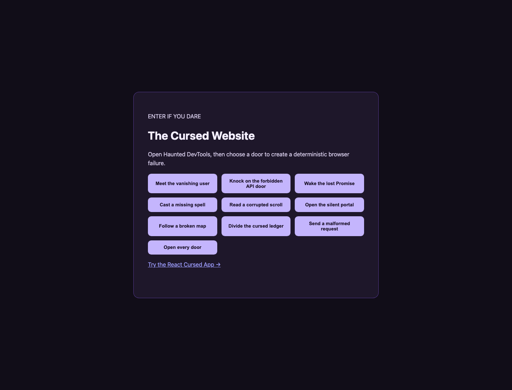
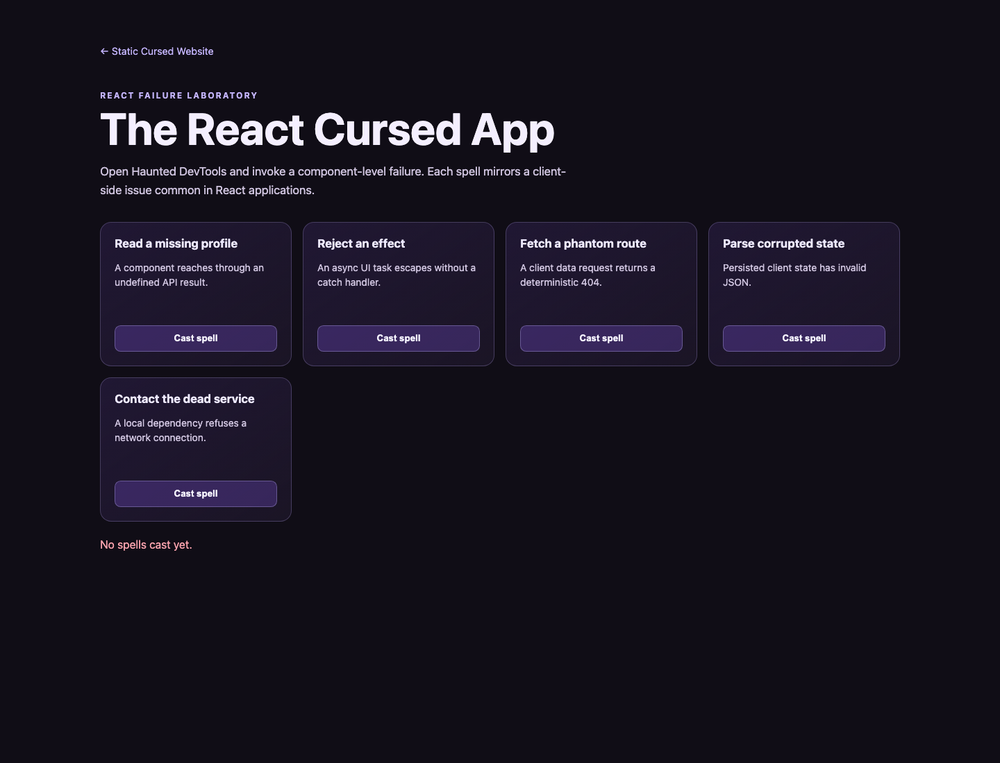

# Haunted DevTools

Haunted DevTools is a local-first Chrome DevTools extension that collects browser failures and asks a locally running Ollama model to explain them in a chosen ghost persona. Event data stays between Chrome and `127.0.0.1` unless you deliberately change the source.

## What it detects

- Uncaught JavaScript runtime errors.
- Unhandled Promise rejections.
- Failed HTTP requests seen by Chrome DevTools: `4xx`, `5xx`, and requests with no response.
- Repeated incidents are grouped by a stable fingerprint, with their occurrence count preserved.

The incident inbox automatically queues diagnoses one at a time while a local model is active. This prevents a burst of errors from overwhelming Ollama.

## Prerequisites

- Google Chrome or another Chromium browser that supports Manifest V3 DevTools extensions.
- Node.js 20 or newer.
- [Ollama](https://ollama.com/) for optional local diagnoses.

## Run from a clean checkout

```bash
git clone <your-repository-url>
cd Haunted-Devtools
npm ci
npm run build
```

Then load the compiled extension:

1. Open `chrome://extensions`.
2. Turn on **Developer mode**.
3. Choose **Load unpacked**.
4. Select this repository's `dist` folder.
5. Open any page, open DevTools, then select the **Haunted DevTools** tab.

After changing extension code, run `npm run build` again and select Chrome's reload button for the extension.

## Use a local Ollama model

The extension supports these exact model tags:

- `gemma4:e2b-it-qat`
- `qwen2.5:7b-instruct`

Install either model locally:

```bash
ollama pull gemma4:e2b-it-qat
# or
ollama pull qwen2.5:7b-instruct
```

Make sure Ollama is running:

```bash
ollama serve
```

From Haunted DevTools, open **AI settings**, select an installed model, and choose **Start model**. Model selection is disabled while a model is resident. Choose **Stop model** to unload the selected model from memory and unlock the selection again.

### Allow the extension to talk to Ollama

Ollama must allow the extension's `chrome-extension://` origin. If model start or diagnosis reports a `403`, stop Ollama, set `OLLAMA_ORIGINS`, and restart it.

For a development session, allow Chrome extension origins:

```bash
OLLAMA_ORIGINS="chrome-extension://*" ollama serve
```

On macOS when Ollama is started as an app/service, set the launch environment first, then fully quit and reopen Ollama:

```bash
launchctl setenv OLLAMA_ORIGINS "chrome-extension://*"
```

For a tighter policy, replace `*` with the specific extension ID shown on `chrome://extensions`. The extension only requests `http://127.0.0.1:11434` and `http://localhost:11434` permissions.

## Try the demo labs

Start the local demo server:

```bash
npm run demo
```

Open one of these pages, then open Chrome DevTools and select **Haunted DevTools**:

- `http://127.0.0.1:5173/demo/cursed-website/` — plain-browser errors, rejected promises, malformed URLs, failed requests, and a burst queue.
- `http://127.0.0.1:5173/demo/react-cursed-app/` — React-style missing state, async effect rejection, failed API request, invalid persisted state, and refused local dependency.

Each lab is deterministic and works offline after Node dependencies and any selected Ollama model are already installed.

## Demo previews





## Product walkthrough

[Watch the recorded walkthrough: trigger one error, select the encountered incident, and read the complete local explanation.](docs/media/haunted-devtools-demo.mp4)

## Privacy boundary

Haunted DevTools is designed to be local-first:

- Runtime and network metadata are collected in the inspected browser session.
- Sanitized event details are sent only to the Ollama API at `127.0.0.1:11434` when you start a model.
- No hosted AI endpoint, telemetry endpoint, or analytics SDK is used.
- The extension does not send request bodies, response bodies, cookies, authorization headers, or local storage values to Ollama.

## Known limitations

- Chrome does not expose an extension API to clear the native Console or Network panels. **Clear session** only clears Haunted DevTools' captured incidents and diagnosis queue.
- Chrome's own console output is not mirrored line-for-line; the extension captures browser runtime errors and unhandled rejections through a main-world bridge.
- The extension must be reloaded after rebuilding, and the inspected page may need a refresh after an extension reload so content scripts attach again.
- Local diagnosis quality and speed depend on the selected model and available local hardware.

## Verification

```bash
npm run typecheck
npm run lint
npm test
npm run build
```

See [the 60-second demo script](docs/DEMO_SCRIPT.md) for a concise release demonstration.
